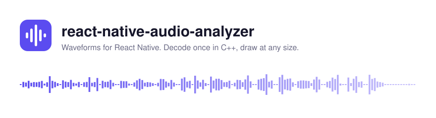
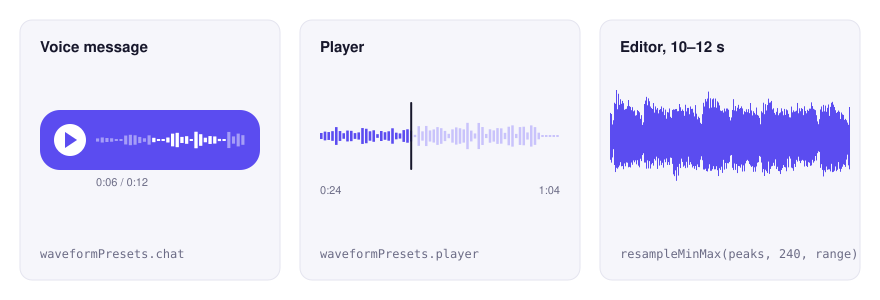

  <a href="https://exzos28.github.io/react-native-audio-analyzer/">
    <picture>
      <source media="(prefers-color-scheme: dark)" srcset="images/banner-dark.svg">
      
    </picture>
  </a>

  

    
    
    
    
  

  

    <a href="https://exzos28.github.io/react-native-audio-analyzer/docs/intro"><b>Documentation</b></a> ·
    <a href="https://exzos28.github.io/react-native-audio-analyzer/docs/examples"><b>Examples</b></a> ·
    <a href="https://exzos28.github.io/react-native-audio-analyzer/docs/api"><b>API</b></a>
  

Waveforms and audio levels for React Native. Decode a file once, natively and off the JS thread, then draw it at any size, zoom and style instantly.

- **Decode once, render many.** One pass produces min, max and RMS per bucket. Changing the bar count, zooming or switching the metric is cheap JS, not another decode.
- **Presets or every knob.** `waveformPresets.chat`, `.player` and `.editor` are tuned for voice messages, scrubbers and precise views. Spread one and override anything.
- **Fast and bounded.** A C++ core on a background thread, chunked decoding with constant memory, progress and `AbortSignal` cancellation.
- **Formats.** WAV, FLAC, MP3 and OGG Vorbis everywhere, plus AAC/M4A and whatever else iOS or Android can decode.
- **Any source.** File paths, `file://` URIs, `http(s)://` URLs (downloaded and cached, with headers) and `ArrayBuffer`s.
- **Bare React Native and Expo**, built on [Nitro Modules](https://nitro.margelo.com).

  <picture>
    <source media="(prefers-color-scheme: dark)" srcset="images/showcase-dark.svg">
    
  </picture>
   
  Rendered from real recordings with the library's own code. <a href="https://exzos28.github.io/react-native-audio-analyzer/docs/examples">More examples →</a>

## Getting started

Install it in a bare React Native app or an Expo development build by following [Installation](https://exzos28.github.io/react-native-audio-analyzer/docs/installation), then draw your first waveform with the [Chat bubbles](https://exzos28.github.io/react-native-audio-analyzer/docs/guides/chat-bubbles) guide.

## Documentation

| | |
| --- | --- |
| [Chat bubbles](https://exzos28.github.io/react-native-audio-analyzer/docs/guides/chat-bubbles) | Presets, list performance, caching results |
| [Players and zoom](https://exzos28.github.io/react-native-audio-analyzer/docs/guides/players-and-zoom) | Scrubbers, progress, zooming without rescaling |
| [Drawing](https://exzos28.github.io/react-native-audio-analyzer/docs/guides/drawing) | Views, SVG and Skia paths, min/max envelopes |
| [Sources and caching](https://exzos28.github.io/react-native-audio-analyzer/docs/guides/sources-and-caching) | URLs, headers, `ArrayBuffer`s, cancellation, the download cache |
| [Supported formats](https://exzos28.github.io/react-native-audio-analyzer/docs/formats) | Codecs per platform and which decoder handles them |
| [How it works](https://exzos28.github.io/react-native-audio-analyzer/docs/concepts/how-it-works) · [Metrics and scaling](https://exzos28.github.io/react-native-audio-analyzer/docs/concepts/metrics-and-scaling) | Buckets, RMS vs peak, linear vs dB |
| [Migrating from v3](https://exzos28.github.io/react-native-audio-analyzer/docs/migration) · [Troubleshooting](https://exzos28.github.io/react-native-audio-analyzer/docs/troubleshooting) | |
| [API reference](https://exzos28.github.io/react-native-audio-analyzer/docs/api) | Every function and option |

## Example apps

[`apps/rn-cli-example`](apps/rn-cli-example) (bare React Native) and [`apps/expo-example`](apps/expo-example) (Expo development build) show the same demo: a chat bubble and a full waveform with every knob. See [CONTRIBUTING.md](CONTRIBUTING.md) to run them.

## Contributing

Issues and pull requests are welcome. [CONTRIBUTING.md](CONTRIBUTING.md) covers the monorepo, tests and releases.

## License

[MIT](LICENSE)
